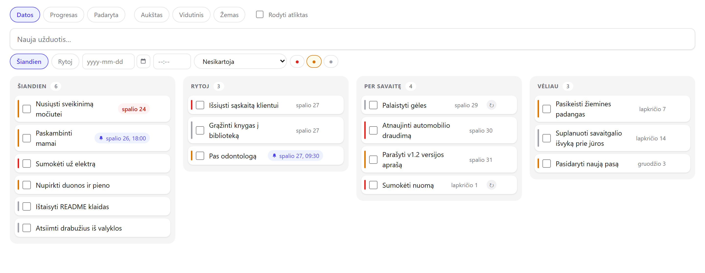
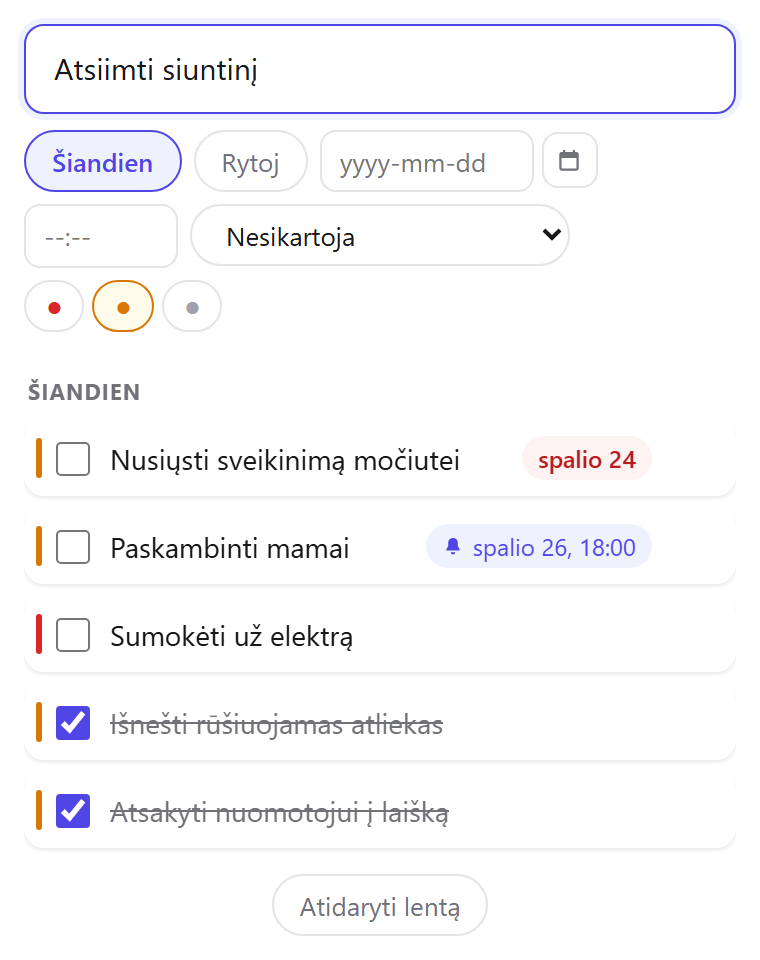
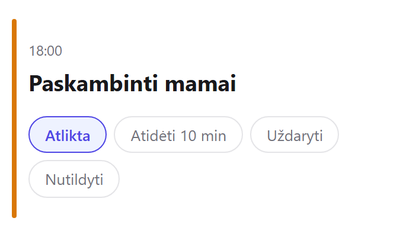
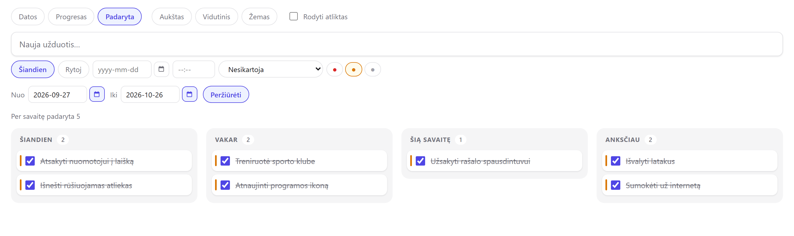
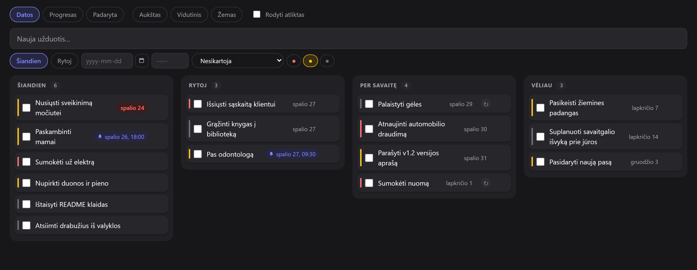

<p align="center">
  
</p>

<h1 align="center">Šarka</h1>

<p align="center">
  <strong>Užduočių sąrašas, kuris gyvena tavo kompiuteryje.</strong><br>
  Greitas įvedimas karštuoju klavišu, rami kanban lenta, priminimai su garsu ir kasdienė atsarginė kopija.<br>
  Be paskyros, be debesies, be interneto.
</p>

<p align="center">
  <a href="README.md">English (Sharka)</a> ·
  <a href="#diegimas">Diegimas</a> ·
  <a href="#kūrimas">Kūrimas iš kodo</a> ·
  <a href="#paremk-projektą">Parama</a>
</p>

<p align="center">
  <a href="LICENSE"></a>
  
  
  <a href="https://ko-fi.com/nerijuscode"></a>
</p>

<p align="center">
  
</p>

---

Šarka yra asmeninė užduočių sistema **vienam žmogui ir vienam namų kompiuteriui**. Ji gyvena
Windows tray'uje prie laikroduko. Bet kurioje programoje paspaudi `Ctrl+Alt+Space`, įrašai, ką
reikia padaryti, spaudi Enter ir grįžti prie savo darbo. Vėliau tą pačią lentą gali atsidaryti
planšetės naršyklėje namų tinkle. Prieiga apsaugota PIN kodu.

Visos užduotys guli SQLite faile tavo kompiuteryje. Šarka neturi paskyrų, telemetrijos,
analitikos ar atnaujinimų tikrinimo ir niekada nesijungia prie jokio serverio internete.

Paukštis šarka, kaip žinia, gerai atsimena, kur ką padėjo. Lietuviškai programa vadinasi
**Šarka**, angliškai **Sharka**.

## Galimybės

- **Įvedimas per dvi sekundes.** Karštasis klavišas bet kurioje programoje atveria mažą langelį.
  Privalomas tik pavadinimas.
- **Lenta rodo, kas svarbu dabar.** Kolonos *Šiandien / Rytoj / Per savaitę / Vėliau* rikiuojasi
  pagal terminą, tada prioritetą, tada sukūrimo laiką. Vienas perjungiklis jas paverčia progreso
  rodiniu (*Reikia padaryti / Vykdoma / Atlikta*) arba *Padaryta* rodiniu.
- **Tempi ir perplanuoji.** Nutempta į *Rytoj* kortelė gauna rytdienos datą, nutempta į *Vykdoma*
  pakeičia būseną. Veikia ir pele, ir pirštu planšetėje.
- **Priminimai atskiru langu**, su garsu ir atidėjimu dešimčiai minučių.
- **Pasikartojančios užduotys**: kas pirmadienį, kas 15 dieną, paskutinę mėnesio dieną ir pan.
- **Matai, ką iš tikrųjų nuveikei.** *Padaryta* rodinys grupuoja atliktas užduotis pagal atlikimo
  laiką (*Šiandien / Vakar / Šią savaitę / Anksčiau*), o virš kolonų rodoma viena eilutė:
  „Per savaitę padaryta 12". Galima peržiūrėti ir bet kurį laikotarpį.
- **Dienos apžvalga** pasirinktais laikais parodo, kas dar liko šiandienai.
- **Kasdienė atsarginė kopija**: visa bazė ir CSV, kurį teisingai atidaro Excel. Laikomos
  septynios paskutinės.
- **Prieiga iš planšetės namų tinkle.** Pagal nutylėjimą išjungta, saugoma PIN kodu, pritaikyta
  pirštui.
- **Lietuvių ir anglų kalbos**, šviesi ir tamsi tema. Abi pagal nutylėjimą seka sistemą.
  Lietuviškai laikas rodomas 24 valandų formatu (`18:00`), angliškai 12 valandų (`6:00 PM`).

<table>
  <tr>
    <td width="50%"><br><sub>Užduotis įvedama iš bet kurios programos</sub></td>
    <td width="50%"><br><sub>Laikas reiškia žadintuvą</sub></td>
  </tr>
  <tr>
    <td><br><sub>Matai, ką iš tikrųjų nuveikei</sub></td>
    <td><br><sub>Tamsi tema planšetei ant naktinio staliuko</sub></td>
  </tr>
</table>

## Kaip Šarka mąsto

Kelios sąmoningos taisyklės skiria Šarką nuo įprastos užduočių programos. Jų laikosi visi
ekranai: lenta, tray langelis, apžvalga ir žadintuvas.

1. **Užduotis be datos reiškia „šiandien".** Datą rašai tik tada, kai sąmoningai atidedi.
   Bedatė užduotis persikelia į kitą dieną ir niekada nebūna pradelsta.
2. **Laikas reiškia žadintuvą.** „Rytoj" yra terminas. „Rytoj 18:00" reiškia, kad 18:00 iššoks
   langas su garsu. Priminimas saugomas atskirai nuo termino, tad atidėjimas termino nekeičia.
3. **Pasikartojanti užduotis neužsidaro.** Pažymėjus ją atlikta, terminas peršoka į kitą kartą.
   Todėl pasikartojančios užduotys niekada nepatenka į *Padaryta* rodinį.
4. **Rankinio rikiavimo nėra.** Tvarka visada ta pati: terminas, prioritetas, sukūrimo laikas.
   Tempimas keičia datą arba būseną, bet ne vietą sąraše.
5. **Funkcijos neauga.** Nėra aprašymų, subužduočių, žymų, projektų, grafikų, serijų ar
   produktyvumo balų. Skaičiuojama tik dviejose vietose, ir abiejose tai vienas skaičius.

## Diegimas

1. Atsisiųsk `Sarka-Setup-<versija>.exe` iš
   [Releases](https://github.com/MisiusCode/Sharka/releases) arba susirink pats su `npm run dist`
   (žr. [Kūrimas](#kūrimas)).
2. Paleisk. Šarka startuoja kartu su Windows ir gyvena tray'uje.

Diegimo failas nepasirašytas, tad Windows SmartScreen gali įspėti. Spausk
*Daugiau informacijos → Vis tiek paleisti* arba susirink diegimo failą iš kodo.

## Naudojimas

| Veiksmas | Kaip |
|---|---|
| Nauja užduotis | `Ctrl+Alt+Space` (keičiamas) arba spustelėjus tray ikoną |
| Lenta | Tray meniu → *Atidaryti lentą* |
| Priminimų garsas | Tray meniu → *Garsas* (visada / tik žadintuvams / išjungta) |
| Nustatymai | Tray meniu → *Nustatymai*: portas, klavišas, apžvalgos laikai, tema, kalba, kopijų aplankas, tinklo prieiga |

- **Grupavimo perjungiklis** lentos viršuje: *Datos*, *Progresas* arba *Padaryta*. *Padaryta*
  rodinyje kortelės netempiamos, nes atlikimo data pasako, kada iš tikrųjų padarei. Laukai
  *Nuo* / *Iki* ir mygtukas *Peržiūrėti* parodo plokščią laikotarpio sąrašą, o *Grįžti* grąžina
  kolonas.
- **Pasikartojanti užduotis** pažymėta ženklu ↻. Kartojimas pasirenkamas termino redaktoriuje:
  savaitės diena arba mėnesio diena (1, 5, 10, 15, 20, 25 arba paskutinė). Rankiniu būdu
  pakeista data vienkart praleidžia kartą, bet kartojimo neatšaukia.
- **Terminas ir žadintuvas atrodo skirtingai.** „Rugpjūčio 20" yra terminas.
  „🔔 rugpjūčio 20, 18:00" suskambės.
- **Kortelės valdikliai atsiranda užvedus pele** (ištrynimo ×, datos brūkšnys). Jutikliniame
  ekrane jie matomi visada.

### Iš planšetės

1. Tray meniu → *Nustatymai* → nustatyk **PIN kodą** ir įjunk **Leisti prieigą iš tinklo**.
2. Paleisk Šarką iš naujo. Nustatymų lange bus parodytas adresas, pvz.,
   `http://192.168.1.20:8080`.
3. Pirmą kartą Windows paklaus apie įeinančius ryšius. Atsakyk „Leisti".
4. Atsidaryk adresą planšetėje ir vieną kartą įvesk PIN. Įrenginys bus prisimintas.

Šarka atpažįsta jutiklinį ekraną ir eilutes bei mygtukus padidina pirštui.

## Tavo duomenys

- Bazė: `%APPDATA%\sarka\tasks.db` (SQLite, WAL režimas).
- Electron naršyklės profilis guli `%APPDATA%\sarka\electron\`. Jis atkuriamas savaime, į kopijas
  neįeina ir gali būti ištrintas be nuostolių.
- **Atsarginė kopija** kartą per parą įrašoma į nustatymuose nurodytą aplanką: `tasks-YYYY-MM-DD.db`
  ir CSV (skirtukas kabliataškis, UTF-8 su BOM, kad Excel'is rodytų lietuviškas raides).
  Numatytasis aplankas yra šalia bazės ir apsaugo tik nuo sugadinto failo. Nuo mirusio disko
  apsaugo tik kopija kitoje vietoje: OneDrive, Dropbox ar tinklo diske.

**Atkūrimas iš kopijos:**
1. Išjunk Šarką.
2. Kataloge `%APPDATA%\sarka\` ištrink `tasks.db-wal` ir `tasks.db-shm`, jei jie yra. Likęs senas
   WAL failas būtų pritaikytas ant atkurtos bazės ir galėtų ją sugadinti.
3. Nukopijuok pasirinktą `tasks-YYYY-MM-DD.db` vietoje `%APPDATA%\sarka\tasks.db`.
4. Paleisk Šarką.

Atkūrimo mygtuko sąsajoje sąmoningai nėra. Jo prireikia kartą gyvenime, o klaidingai paspaustas
jis sunaikintų dabartinius duomenis.

## Saugumas namų tinkle

- Pagal nutylėjimą serveris klausosi tik `127.0.0.1`, tad iš tinklo jo nepasieksi.
- Tinklo prieigą (`0.0.0.0`) reikia įjungti sąmoningai, ir tai leidžiama tik nustačius PIN.
- Pačios programos užklausos (Electron langai per loopback) PIN niekada neklausiamos. Kitas
  įrenginys pirma turi jį įvesti ir tik tada gauna pasirašytą sesijos slapuką.
- Slapuko raktas išvedamas iš PIN maišos **ir** atskiros serverio paslapties. Pakeitus ar
  pašalinus PIN, atsijungia visi įrenginiai iš karto.
- Penki klaidingi PIN bandymai iš to paties adreso jį užrakina 15 minučių.
- PIN saugomas tik kaip maiša ir per API niekada negrįžta.
- Nustatymų ekranas atiduodamas tik `127.0.0.1`. PIN keitimui iš tinklo reikia dabartinio PIN.
- Tikrinama `Host` antraštė, kad būtų užkirstas kelias DNS rebinding atakoms.
- Kopijoje lieka PIN maiša, tad atkūrus PIN išlieka. Sesijos paslaptis kopijoje **nunulinama**,
  tad kopijos turėtojas negali pats pasirašyti sesijos.

Tai nėra pilnas apsaugos sprendimas. Nėra HTTPS, nėra atskirų paskyrų, o PIN žinantis
įrenginys turi pilną valdymo teisę. Tinkle, kuriuo nepasitiki, tinklo prieigos neįjunk.

## Žinomi apribojimai

- Pakeitus **portą** ar **tinklo prieigą**, reikia paleisti programą iš naujo.
- **Nustatymų** pakeitimai nepasiekia jau atidarytų langų, juos reikia atidaryti iš naujo. Tray
  meniu ir Chromium'o kontekstiniai meniu kalbą pakeičia tik paleidus programą iš naujo.
- **Pasikartojančios užduotys neturi istorijos.** Tai viena užduotis, kuri kilnojasi į priekį.
  Ją ištrynus dingsta ir visi būsimi kartai.
- Atlikimo laikas saugomas UTC, o kolonos skaičiuojamos pagal vietinę datą, tad iškart po
  vidurnakčio atlikta užduotis *Padaryta* rodinyje gali atsidurti po *Vakar*.
- Darbalaukio programa kuriama ir testuojama tik **Windows**.

## Kūrimas

Reikia **Node.js 22+**, o darbalaukio programai ir Windows. Core, serverio ir UI testai sukasi ir
kitur.

```sh
npm install
npm run app          # build + Electron programa iš kodo
npm test             # vienetiniai ir integraciniai testai (Vitest, jsdom)
npm run typecheck    # tsc --noEmit
npm run test:e2e     # Playwright prieš gyvą serverį (portas 8099, duomenys .e2e/)
npm run dist         # NSIS diegimo failas į dist-installer/

npm start            # tik serveris (prieš tai `npm run build:ui`)
npm run dev:ui       # Vite su karštu perkrovimu; /api į :8080, kartu sukasi `npm start`
```

### Architektūra vienoje pastraipoje

Viename Electron procese gyvena SQLite bazė (better-sqlite3), Express serveris, tray ikona,
globalus karštasis klavišas ir priminimų bei kopijų planuokliai. Kiekvienas langas, taip pat ir
Electron viduje, kreipiasi į tą patį `http://127.0.0.1:<portas>/api`, kaip ir planšetė, todėl
atskiro IPC kelio prie duomenų nėra. Gyvi atnaujinimai ateina per SSE. Dalykinės taisyklės
gyvena tik `src/core/` (be Electron, be Express, su įšvirkščiamu laikrodžiu), o React sąsaja
importuoja iš jo tiesiogiai.

```
src/core/      dalykinė logika: užduotys, kolonos, kartojimas, nustatymai, kopijos, i18n, PIN
src/server/    tik Express transportas: validacija, HTTP kodai, autentikacija, SSE, statika
src/desktop/   Electron klijai: tray, langai, karštasis klavišas, autostartas, žadintuvų eilė
src/ui/        React: lenta, greitas įvedimas, žadintuvas, apžvalga, nustatymai
tests/         core | server | desktop | ui (Vitest) ir e2e (Playwright)
```

[`docs/architektura.md`](docs/architektura.md) yra išsamus inžinerinis vadovas: sluoksnių
taisyklės, išjungimo tvarka, migracijos ir testavimo konvencijos.

### Aplinkos kintamieji

| Kintamasis | Poveikis |
|---|---|
| `SARKA_DATA` | Duomenų katalogas vietoj `%APPDATA%/sarka` |
| `SARKA_PORT` | Portas vietoj saugomo bazėje |
| `SARKA_RESET=1` | **Ištrina visą `SARKA_DATA` katalogą** paleidžiant. Tik testams ir tik kartu su `SARKA_DATA`. |

## Prisidėk

Klaidų pranešimai ir pull request'ai laukiami lietuviškai arba angliškai. Apie saugumo spragas —
[SECURITY.md](SECURITY.md).

- Kodo komentarai, commit'ai ir `docs/` rašomi **lietuviškai**. Naudotojui matomi tekstai
  gyvena `src/core/i18n.ts` abiem kalbomis.
- Dirbama TDD principu. Pridėk testus ir prieš PR paleisk `npm test` bei `npm run typecheck`.
- Prieš siūlydamas naują funkciją, perskaityk skyrių „Kaip Šarka mąsto". Daug „trūkstamų"
  funkcijų nėra sąmoningai.

## Paremk projektą

Šarka nemokama ir atviro kodo, ir tokia liks. Jei ji tau sutaupo kelias minutes per dieną ir
nori padėkoti, gali nupirkti man kavos:

<a href="https://ko-fi.com/nerijuscode"></a>

Padeda ir žvaigždutė repozitorijai, klaidų pranešimai ar rekomendacija draugui.

## Licencija

[MIT](LICENSE) © Nerijus Misius
