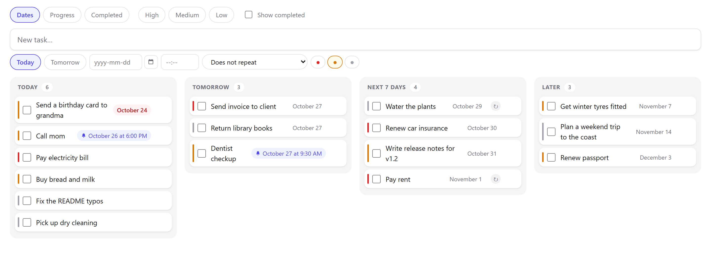
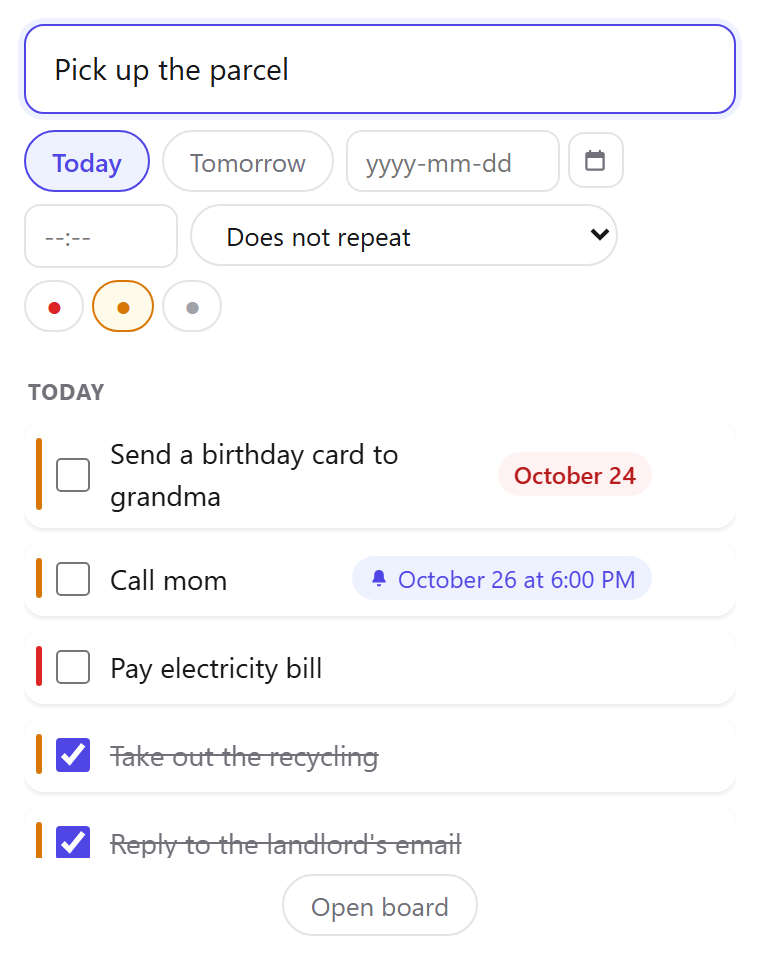
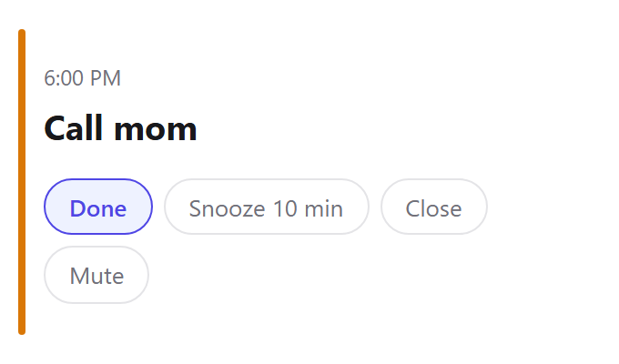
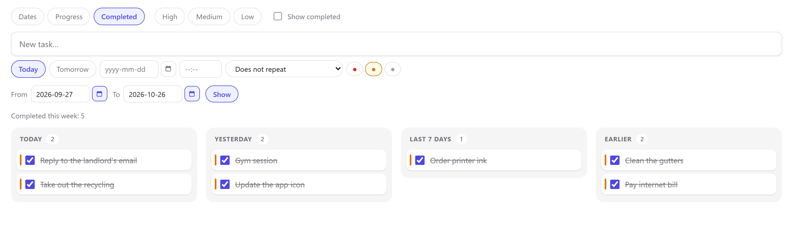
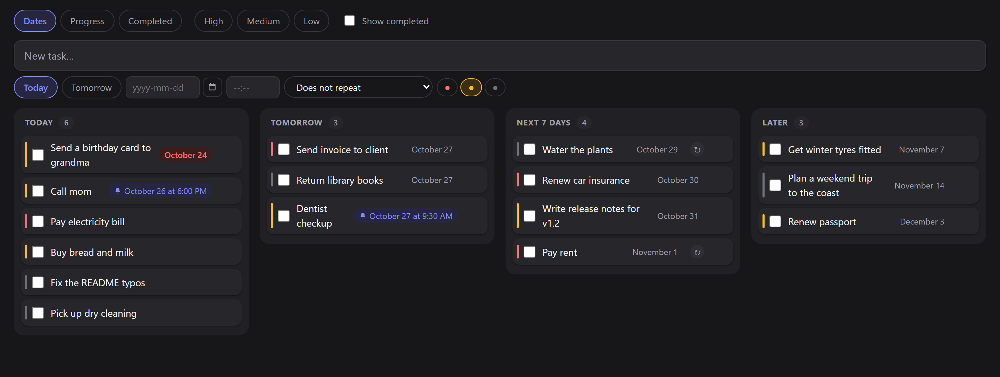
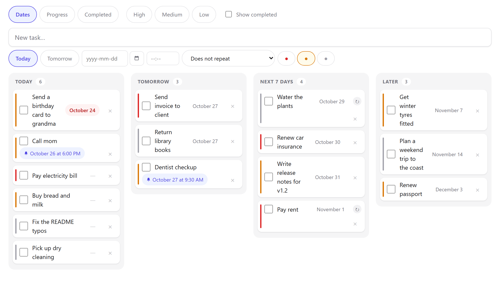

<p align="center">
  
</p>

<h1 align="center">Sharka</h1>

<p align="center">
  <strong>A task list that lives on your own computer.</strong><br>
  Global-hotkey capture, a calm kanban board, alarms with sound and a daily backup.<br>
  No account, no cloud, no internet required.
</p>

<p align="center">
  <a href="README.lt.md">Lietuviškai (Šarka)</a> ·
  <a href="#install">Install</a> ·
  <a href="#development">Build from source</a> ·
  <a href="#support-the-project">Support</a>
</p>

<p align="center">
  <a href="LICENSE"></a>
  
  
  <a href="https://ko-fi.com/nerijuscode"></a>
</p>

<p align="center">
  
</p>

---

Sharka is a personal task system for **one person and one home computer**. It sits in the
Windows tray next to the clock. Press `Ctrl+Alt+Space` in any app, type what you need to do,
press Enter, and get back to work. Later you can open the same board in a tablet browser
on your home network, protected by a PIN.

Every task lives in a SQLite file on your machine. Sharka has no accounts, telemetry,
analytics or update pings, and it never connects to a server on the internet.

*Šarka* (SHAR-ka) is Lithuanian for *magpie*, a bird that remembers where it put things.
The app is called **Šarka** in Lithuanian and **Sharka** in English.

## Features

- **Two-second capture.** A global hotkey opens a small window from any application. Only
  the title is required.
- **A board that shows what matters now.** Columns *Today / Tomorrow / Next 7 days / Later*,
  sorted by due date, then priority, then creation time. One switch turns them into a progress
  view (*To do / In progress / Done*) or a *Completed* view.
- **Drag to reschedule.** Dragging a card into *Tomorrow* sets tomorrow's date; dragging it into
  *In progress* changes its status. This works with a mouse and with a finger on a tablet.
- **Alarms in their own window**, with sound and a ten-minute snooze.
- **Repeating tasks**: every Monday, on the 15th, on the last day of the month, and so on.
- **What you actually finished.** The *Completed* view groups finished tasks by when you
  finished them (*Today / Yesterday / Last 7 days / Earlier*), with a single line:
  "Completed this week: 12". Pick any date range to review a period.
- **Daily digest** at the times you choose, showing what is still left for today.
- **Daily backup** of the whole database plus a CSV copy that Excel opens correctly. The last
  seven are kept.
- **Tablet access on your home network**, off by default, PIN-protected and touch-friendly.
- **English and Lithuanian**, with light and dark themes. Both follow the system by default.
  English uses a 12-hour clock (`6:00 PM`), Lithuanian a 24-hour one (`18:00`).

<table>
  <tr>
    <td width="50%"><br><sub>Quick capture from any app</sub></td>
    <td width="50%"><br><sub>A time means an alarm</sub></td>
  </tr>
  <tr>
    <td><br><sub>See what you actually finished</sub></td>
    <td><br><sub>Dark theme for the tablet on the nightstand</sub></td>
  </tr>
</table>

## How Sharka thinks

A few deliberate rules make Sharka different from a typical to-do app. Every screen follows
them: the board, the tray window, the digest and the alarm.

1. **A task with no date means *today*.** You only set a date when you consciously put
   something off. An undated task rolls over to the next day and is never "overdue".
2. **A time means an alarm.** "Tomorrow" is a due date. "Tomorrow 6:00 PM" opens a window with
   sound at six. Reminders are stored separately from due dates, so snoozing never moves the
   deadline.
3. **Repeating tasks don't close.** Ticking one off moves its due date to the next occurrence.
   For that reason repeating tasks never show up in the *Completed* view.
4. **There is no manual sorting.** Order is always due date, then priority, then creation
   time. Dragging changes a card's date or status, never its position in the list.
5. **It does not grow features.** Sharka has no descriptions, subtasks, tags, projects, charts,
   streaks or productivity scores. Counting is limited to one number in two places.

## Install

1. Download `Sarka-Setup-<version>.exe` from
   [Releases](https://github.com/MisiusCode/Sharka/releases), or build it yourself with
   `npm run dist` (see [Development](#development)).
2. Run it. Sharka starts with Windows and lives in the tray.

Windows SmartScreen may warn you because the installer is not code-signed. Choose
*More info → Run anyway*, or build the installer from source.

## Using it

| Action | How |
|---|---|
| Add a task | `Ctrl+Alt+Space` (configurable) or click the tray icon |
| Open the board | Tray menu → *Open board* |
| Reminder sound | Tray menu → *Sound* (always / alarms only / off) |
| Settings | Tray menu → *Settings*: port, hotkey, digest times, theme, language, backup folder, network access |

- **Grouping switch** at the top of the board: *Dates*, *Progress* or *Completed*. In
  *Completed*, cards can't be dragged, because the completion date records when you really did
  it. Use *From* / *To* and *Show* to see a flat list of everything finished in a period;
  *Back* returns to the columns.
- **Repeating tasks** carry a ↻ mark. Choose the pattern in the due-date editor: a weekday, or a
  day of the month (1, 5, 10, 15, 20, 25 or the last day). Changing the date by hand skips one
  occurrence without cancelling the repetition.
- **A due date and an alarm look different.** "Aug 20" is a due date. "🔔 Aug 20, 6:00 PM" will
  ring.
- **Card controls appear on hover** (delete ×, date dash). On touch screens they're always
  visible.

### From a tablet

1. Tray menu → *Settings* → set a **PIN**, then turn on **Allow access from the network**.
2. Restart Sharka. The settings window shows the address to open, for example
   `http://192.168.1.20:8080`.
3. The first time Windows asks about incoming connections, choose *Allow*.
4. Open the address on the tablet and enter the PIN once. The device stays signed in.

Sharka detects touch input and enlarges rows and buttons for fingers.

<p align="center"></p>

## Your data

- Database: `%APPDATA%\sarka\tasks.db` (SQLite in WAL mode).
- Electron's own browser profile lives in `%APPDATA%\sarka\electron\`. It is rebuilt
  automatically, is not backed up, and can be deleted safely.
- **Backups** run once a day into the folder set in Settings, as `tasks-YYYY-MM-DD.db` plus a CSV
  file (semicolon-separated, UTF-8 with BOM, so Excel reads it correctly). The default folder is
  next to the database, which only protects against a corrupted file. Point it at OneDrive,
  Dropbox or a network drive to survive a dead disk.

**Restoring from a backup:**
1. Quit Sharka.
2. In `%APPDATA%\sarka\`, delete `tasks.db-wal` and `tasks.db-shm` if they exist. A leftover WAL
   file would be replayed onto the restored database and could corrupt it.
3. Copy the chosen `tasks-YYYY-MM-DD.db` over `%APPDATA%\sarka\tasks.db`.
4. Start Sharka.

The UI deliberately has no restore button. You need it about once in a lifetime, and a
mis-click would destroy your current data.

## Security on a home network

- By default the server listens on `127.0.0.1` only and can't be reached from the network.
- Network access (`0.0.0.0`) must be turned on explicitly, and only after a PIN is set.
- Requests from the app itself (the Electron windows over loopback) never need the PIN. Any
  other device must enter it first. After that it gets a signed session cookie.
- The cookie key is derived from the PIN hash **and** a separate server-side secret. Changing or
  removing the PIN signs out every device at once.
- Five wrong PINs from one address lock it out for 15 minutes.
- The PIN is stored only as a hash and is never returned by the API.
- The settings screen is served to loopback only. Changing the PIN over the network requires the
  current PIN.
- The `Host` header is checked to block DNS-rebinding attacks.
- Backups keep the PIN hash, so a restore keeps your PIN. They do **not** keep the session
  secret, so whoever holds a backup can't forge a session.

This is not a complete security solution. There is no HTTPS and there are no separate
accounts, and any device that knows the PIN has full control. Don't enable network access on a
network you don't trust.

## Known limitations

- Changing the **port** or **network access** takes effect after a restart.
- Changing **settings** doesn't reach windows that are already open. Reopen them. The tray menu
  and Chromium's built-in context menus switch language only after a restart.
- **Repeating tasks have no history**: each one is a single task that moves forward. Deleting it
  removes all future occurrences.
- Completion times are stored in UTC while columns use local dates. A task finished just after
  midnight can appear under *Yesterday* in the *Completed* view.
- The desktop app is built and tested on **Windows** only.

## Development

Requirements: **Node.js 22+** and Windows for the desktop app. The core, server and UI tests
also run elsewhere.

```sh
npm install
npm run app          # build + launch the Electron app from source
npm test             # unit + integration tests (Vitest, jsdom)
npm run typecheck    # tsc --noEmit
npm run test:e2e     # Playwright against a live server (port 8099, data in .e2e/)
npm run dist         # NSIS installer into dist-installer/

npm start            # server only (needs `npm run build:ui` first)
npm run dev:ui       # Vite with hot reload; proxies /api to :8080, run `npm start` alongside
```

### Architecture in one paragraph

A single Electron process hosts a SQLite database (better-sqlite3), an Express server, a tray
icon, a global hotkey and the reminder/backup schedulers. Every window, including the ones
inside Electron, talks to the same `http://127.0.0.1:<port>/api` that the tablet uses, so there
is no separate IPC path to the data. Live updates arrive over SSE. Business rules live only in
`src/core/` (no Electron, no Express, with an injectable clock), and the React UI imports from it
directly.

```
src/core/      domain logic: tasks, buckets, repeat, settings, backup, i18n, PIN
src/server/    Express transport only: validation, HTTP codes, auth, SSE, static files
src/desktop/   Electron glue: tray, windows, hotkey, autostart, alarm queue
src/ui/        React: board, quick add, alarm, digest, settings
tests/         core | server | desktop | ui (Vitest) and e2e (Playwright)
```

[`docs/architektura.md`](docs/architektura.md) (in Lithuanian) is the detailed engineering guide:
layering rules, shutdown order, migrations and testing conventions.

### Environment variables

| Variable | Effect |
|---|---|
| `SARKA_DATA` | Data directory instead of `%APPDATA%/sarka` |
| `SARKA_PORT` | Port instead of the one stored in the database |
| `SARKA_RESET=1` | **Deletes the whole `SARKA_DATA` directory** on start. Test use only, and only together with `SARKA_DATA`. |

## Contributing

Issues and pull requests are welcome, in English or Lithuanian. For security problems, see
[SECURITY.md](SECURITY.md).

- Code comments, commit messages and `docs/` are in **Lithuanian** by project convention.
  User-facing strings live in `src/core/i18n.ts` in both languages.
- The project is developed test-first. Please include tests and run `npm test` and
  `npm run typecheck` before opening a PR.
- Read the product limits in "How Sharka thinks" before proposing a feature. Many "missing"
  features are left out on purpose.

## Support the project

Sharka is free and open source, and it will stay that way. If it saves you a few minutes a day
and you'd like to say thanks, you can buy me a coffee:

<a href="https://ko-fi.com/nerijuscode"></a>

Starring the repo, reporting bugs and telling a friend help too.

## License

[MIT](LICENSE) © Nerijus Misius
